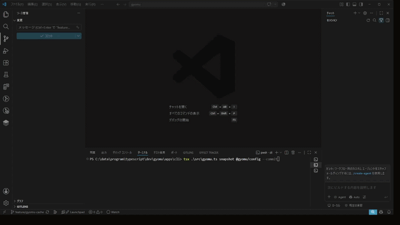
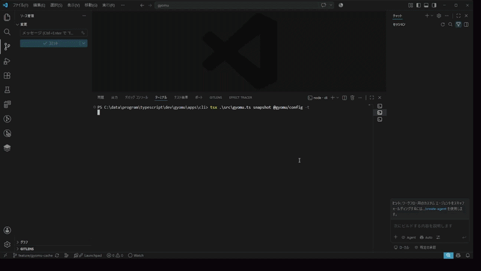

# Gyomu

[US English](README.md) | JP 日本語

> **ドキュメントやテストの手動メンテナンスから解放されよう。Python で、自分自身の AI コーディングハーネスを構築する。**

[](https://www.python.org/)
[](LICENSE)

**Gyomu** は、リポジトリを中心に動作するオープンな AI エージェントシステムです。**Python の docstring 生成、ディレクトリ・パッケージ単位の設計概念の抽出、多言語 README の生成**を自動化し、継続的にメンテナンスします。

さらに、アーキテクチャ、設計原則、編集ルール、重要な制約など、プロジェクトの知識をまとめた LLM Context ドキュメントの生成・管理も行います。

将来的には、コードの変更に合わせてテストコードの同期や修正など、関連する開発資産の更新・保守も自動化できるよう、機能を拡張していくことを目指しています。

AI プロバイダーのブラックボックス化されたプラットフォームにエージェントのフィードバックループを閉じ込めるのではなく、Gyomu はコンテキスト、評価基準、知識を YAML の知識ファイル、Python の docstring、テストコードなど、人が読める形式の成果物としてリポジトリ内に保持します。

本プロジェクトはモノレポ構成を採用しています。

**ルートパッケージ以外のパッケージに関するドキュメントも、Python の docstring や README.md を含め、Gyomu によって自動生成・管理されます。**

---

## 動作要件

- Python 3.13 以降
- 依存関係管理ツール [uv](https://docs.astral.sh/uv/)
- LLM による生成機能を利用するための AI プロバイダー API キー

Gyomu は開発コストを抑え、選択したプロバイダー、モデル、利用量に応じて、AI サービスの無料利用枠内でも運用できるワークフローを目指して設計されています。

---

## ⚡ デモ

### 1. 多言語 README 生成

コードベースの構造、抽出したパッケージの設計概念、シンプルな YAML 形式の知識ファイルをもとに、多言語 README を生成・管理します。



### 2. Docstring・コンテキストの自動抽出

Python コードを解析し、docstring、ディレクトリ・パッケージ単位の設計概念、LLM Context ドキュメントを生成することで、実装とドキュメントの整合性を維持します。



---

## 💡 なぜ Gyomu なのか？

### 1. 「ドキュメントとテストのメンテナンス地獄」からの解放

高品質な AI コーディングには、最新の docstring、アーキテクチャのコンテキスト、そして堅牢なテストスイートが必要です。しかし、これらを手動で維持することは、開発者にとって非常に手間と時間のかかる作業です。

ドキュメントの生成・メンテナンスをエージェントに委ねることで、**開発者は創造的なコーディングとシステム設計に、より多くの時間とエネルギーを注げるようになります。**

Gyomu は将来的に、テストなどの開発資産にもこの仕組みを拡張し、実装と検証の整合性を保つことを目指しています。

### 2. プラットフォームに依存しない「オープンなハーネス」

近年の AI コーディングツールは、計画・テスト・修正といったフィードバックループを、独自のエコシステムに統合する傾向があります。

Gyomu は、リポジトリを中心としたアプローチを採用しています。ルール、ドメイン概念、アーキテクチャの知識、開発コンテキストを、確認・編集可能な成果物としてリポジトリ内に保持します。

プロジェクトの知識を自分たちで管理できるようにし、特定の AI プロバイダーへの依存を軽減します。

### 3. Python の型システムと明示的な依存関係に基づく設計

Gyomu は、Python の型システム、厳格な静的型チェック、明示的な依存性注入を活用し、ワークフローの理解・テスト・保守を容易にします。

AI 基盤は、リトライポリシー、モデルルーティング、フォールバック機構をサポートしています。また、Pydantic によってデータ境界でのスキーマ検証を行い、`returns` の `Result`、`Success`、`Failure` によってエラー処理を明示します。

これにより、予測可能なワークフローと保守性を重視した、モジュール型の AI エージェントシステムを実現します。

---

## 🛠 技術スタック

- **言語：** Python 3.13 以降
- **パッケージ・環境管理：** [uv](https://docs.astral.sh/uv/)
- **データ検証：** [Pydantic](https://docs.pydantic.dev/)
- **明示的なエラー処理：** [returns](https://returns.readthedocs.io/)
- **静的型チェック：** [mypy](https://mypy.readthedocs.io/)
- **リンター：** [Ruff](https://docs.astral.sh/ruff/)
- **テスト：** [pytest](https://docs.pytest.org/)
- **AI 連携：** Pydantic AI および対応する LLM プロバイダー
- **設定・知識管理：** YAML、Python の docstring、リポジトリ構造

---

## 🤝 コントリビューター募集中！

Gyomu のビジョンに共感し、一緒に開発を進めてくれるコントリビューターを歓迎します。

- 💡 **Python アーキテクチャに関心のある方：** 厳格な型付けを活用した、保守性の高い AI エージェントのワークフロー構築。
- 🧪 **テスト・コンテキストの開拓者：** コード、ドキュメント、テストの整合性を維持するインテリジェントなワークフローの開発。
- 🌐 **プロンプト・国際化エンジニア：** 多言語生成プロンプト、知識スキーマ、ドキュメント品質の改善。

### 参加方法

- [GitHub Discussions](https://github.com/Yoshihisa-Matsumoto/Gyomu_Python/discussions) で議論に参加してください。
- [Good First Issues](https://github.com/Yoshihisa-Matsumoto/Gyomu_Typescript/issues?q=is%3Aissue+is%3Aopen+label%3A%22good+first+issue%22) から、最初のコントリビューションに取り組んでみてください。

---

## 📖 クイックスタート

```bash
# リポジトリをクローン
git clone https://github.com/Yoshihisa-Matsumoto/Gyomu_Python.git
cd gyomu_python

# 依存関係をインストール
uv sync

# CLI を起動して利用可能なコマンドを確認
uv run gyomu --help
```

利用可能なコマンドやオプションについては、CLI のヘルプを参照してください。

---

## 📜 ライセンス

MIT

## 関連ドキュメント

- 📖 [アーキテクチャガイド](Architecture.md)
